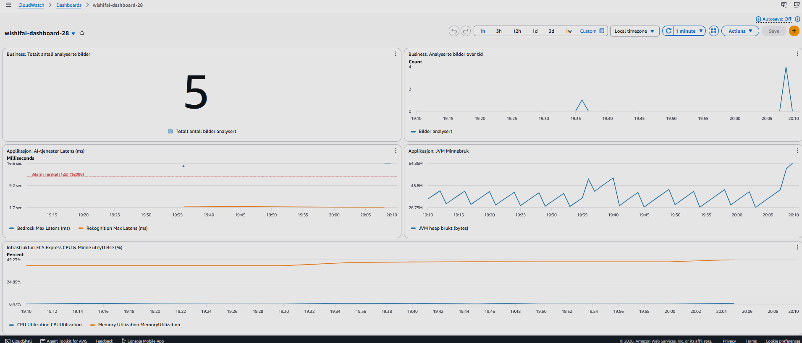

## Oppgave 1: Container og CI (20p)

### 1A: Containerisér Spring Boot-applikasjonen
I denne Dockerfilen brukes det multi-stage build til å bygge og kjøre applikasjonen:

1. **Builder-steget:**
    * `maven:3.9-eclipse-temurin-21` er valgt fordi applikasjonen og utviklingsmiljøet bruker Java 21.
    * Oppretter `/app` som working directory.
    * Kopierer over `pom.xml` og hele `src`-mappen.
    * Kjører `mvn package -DskipTests` for å kompilere koden og lage JAR-filen. Ved å hoppe over testene under byggingen av imaget går byggingen raskere.

2. **Runtime-steget:**
    * Bytter til et minimalistisk `eclipse-temurin:21-jre-alpine`-image og kopierer den ferdig bygde `.jar`-filen over til `/app/application.jar`.
    * Resultat: Ved å gjøre det på denne måten slipper jeg å drasse med meg Maven, kildekoden og tunge byggeverktøy inn i det endelige imaget. Imaget blir mye mindre i størrelse, det starter raskere, og det er bedre for sikkerheten fordi det inneholder færre ubrukte filer.

3. **Bygge og kjøre Dockerfilen:**
    1. Stå i rotmappen i prosjektet
    2. Kjør denne kommandoen for å bygge: `docker build -t wishifai-app .`
    3. Kjør denne kommandoen for å starte på port 9999: `docker run -p 9999:8080 --name wishifai-container wishifai-app`

---

### 1B: CI-pipeline og tagging-strategi
* Jeg har opprettet en GitHub Actions workflow (`.github/workflows/docker.yml`) som bygger og pusher Spring Boot-containeren til Amazon ECR.
* Workflowen er konfigurert til å kun kjøre automatisk ved `push` til `main`-branchen.
* Autentiseringsnøkler (`AWS_ACCESS_KEY_ID` og `AWS_SECRET_ACCESS_KEY`) er lagret i GitHub Secrets, og ingen følsom informasjon er eksponert i workflow-filen.
* ECR-repositoryet `wishifai-app-k28` ble opprettet i AWS-region `eu-west-1` via AWS CLI.

#### Begrunnelse for tagging-strategi:
I min pipeline har jeg valgt en kombinert tagging-strategi som pusher med både **kort commit-SHA (`$rev`)** og **`latest`**:

1. **Commit-SHA (`git rev-parse --short HEAD`):**
   Dette gir full sporbarhet og uforanderlighet. Hver commit som merges til `main` genererer en unik tagg koblet direkte til kildekoden. Dette gjør det enkelt å spore nøyaktig hvilken kildekodeversjon som kjører i miljøet, samt rulle tilbake dersom en feil oppstår.
2. **`latest`:**
   `latest`-taggen oppdateres ved hver vellykkede kjøring. Dette gjør det praktisk for sensor og andre utviklere å hente ut det til enhver tid nyeste imaget uten å måtte slå opp den spesifikke SHA-koden.

**Lenke til vellykket workflow-kjøring:**
https://github.com/Phankev24/PGR301-Eksamen-2026/actions/runs/41540353639/job/125605785656

---

## Oppgave 2: ECS Express med Terraform (25p)

### 2A: Infrastruktur for tjenesten

**Offentlig URL til tjenesten:** https://wi-97007aeba8eb418bb591ff07be39cddf.ecs.eu-west-1.on.aws

**Eksempel på testkommando (curl):**
curl -F "image=@samples/sample_image.png" https://wi-97007aeba8eb418bb591ff07be39cddf.ecs.eu-west-1.on.aws/api/analyze

URL-en eksponeres også som Terraform-output (`service_url`). Den vises i loggen til Terraform-jobben i GitHub Actions, og lokalt med `terraform output service_url`.

### All Terraform-kode for infrastrukturen ligger i mappen infra/. Løsningen oppretter følgende komponenter:

**S3 Bucket (wishifai-images-k28):**

* Opprettet S3-bucket for lagring av bilder lastet opp til applikasjonen. Bucketen har force_destroy = true for ryddig ressurshåndtering, og blokkerer offentlig tilgang direkte via aws_s3_bucket_public_access_block.

**IAM Task Role (wishifai-task-role-k28):**

* Opprettet en dedikert task role for applikasjonen for å sikre "least privilege". Rollen har en inline-policy med tillatelser til:

**S3:** Lese, skrive og liste objekter i wishifai-images-k28.

**AWS Rekognition:** DetectLabels og DetectText for å hente ut objekter fra bilder.

**AWS Bedrock:** InvokeModel for å generere gaveforslag via LLM.

**CloudWatch:** PutMetricData for at Spring Boot (Micrometer) skal få levert metrikker under kjøring.

**ECS Express Service (aws_ecs_express_gateway_service):**

* Tjenesten benytter de eksisterende fellesrollene i AWS-kontoen for execution (ecsTaskExecutionRole) og infrastruktur (ecsInfrastructureRoleForExpressServices), samt den nyopprettede task-rollen.

* Miljøvariabelen S3_BUCKET settes automatisk i Terraform ved å hente navnet fra S3-ressursen (aws_s3_bucket.images.bucket).

* Helsesjekksti er eksplisitt satt til health_check_path = "/actuator/health" slik at ECS Express gjenkjenner at Spring Boot-containeren er frisk og kan rute trafikk til den.

* Variabler benyttes for region, kandidatnummer og Docker-image for fleksibel konfigurasjon.

---
### 2B: Remote State
**Terraform-state er konfigurert til å lagres i en S3 backend i stedet for lokalt på maskinen.**
* **Backend Bucket:** pgr301-terraform-state
* **State Key Path:** wishifai/k28/terraform.tfstate
* **Region:** eu-west-1

Kandidatnummeret i nøkkelen gjør at state-filen er unik for meg i den delte bucketen. Da kan flere utviklere (og GitHub Actions) jobbe mot samme state i stedet for hver sin lokale kopi.

---
### 2C: GitHub Actions-job for Terraform
Pipelinen i `.github/workflows/docker.yml` har to jobber som kjører etter hverandre: `push_to_registry` og `terraform`. Terraform-jobben har `needs: push_to_registry`. Før `terraform apply` kjører `terraform fmt -check`, så pipelinen feiler hvis koden ikke er riktig formatert.

Bygg-jobben sender image-taggen (kort commit-SHA) videre til Terraform-jobben som et job-output (`image_tag`). Terraform bruker den i `-var="image_tag=..."`, slik at ECS får akkurat det imaget som nettopp ble bygd.

### Hvorfor Terraform må kjøre ETTER container-build:
1. **Unngå feil ved utrulling:** Hvis Terraform oppdaterer ECS før imaget ligger i ECR, prøver ECS å hente et bilde som ikke finnes ennå, og containeren krasjer.
2. **Sikre at koden bygger:** Hvis bygget av Docker-imaget feiler, kjører ikke Terraform. Dermed ruller vi ikke ut ødelagte endringer.
3. **Riktig versjon:** Terraform må vite den nøyaktige Commit SHA-tagen fra bygg-steget for å oppdatere ECS med riktig image.

**Lenke til grønn kjøring med begge jobbene:**
https://github.com/Phankev24/PGR301-Eksamen-2026/actions/runs/41540353639/job/125605785656

---

## Oppgave 3: Observability (20p)

### 3A: Metrikker i applikasjonen

For å finne ut hvorfor applikasjonen svarer tregt og se hvordan den brukes, har vi lagt inn metrikker med Micrometer. Disse sendes automatisk til AWS CloudWatch under navnerommet `wishifai-28`.

Vi har valgt å måle følgende:

1. **`rekognition.execution.time` (Timer)**
   - **Hva den gjør:** Måler hvor lang tid AWS Rekognition bruker på å finne objekter i bildet.
   - **Hvorfor:** Siden dette er et eksternt kall, vil vi se om det er bildegjenkjenningen som gjør at brukerne må vente. En `Timer` gir oss gjennomsnittstid og maksimaltid. I CloudWatch heter metrikkene `.avg`, `.max`, `.sum` og `.count`, og dashbordet bruker `.max`.

2. **`bedrock.execution.time` (Timer)**
   - **Hva den gjør:** Måler hvor lang tid AWS Bedrock (Claude LLM) bruker på å generere gaveforslagene.
   - **Hvorfor:** AI-modeller bruker ofte lang tid på å svare. Metrikken bekrefter om det er Bedrock som er hovedårsaken til tregheten (i testene våre tok dette ca. 15-17 sekunder).

3. **`wishifai.images.analyzed` (Counter, business-metrikk)**
   - **Hva den gjør:** Teller totalt antall bilder som har blitt sendt inn og analysert. I CloudWatch heter den `wishifai.images.analyzed.count`, fordi Micrometer legger på `.count`.
   - **Hvorfor:** Dette viser den faktiske bruken av tjenesten over tid. Det gir nyttig innsikt for investorer og driftsteamet om hvor populær appen er, helt uavhengig av tekniske feil.

---

### 3B: Dashboard og alarm

Dashboard og alarm er definert som kode i `infra/monitoring.tf`.

**Dashboard:** `wishifai-dashboard-28`

Dashbordet har fem widgets som viser tre typer metrikker:

1. **Business: `wishifai.images.analyzed.count`** (to widgets)
   - Den ene viser totalt antall analyserte bilder, den andre viser bruken over tid.
   - Hvorfor: Dette sier noe om hvor mye tjenesten faktisk brukes, ikke bare om den er teknisk frisk.

2. **Applikasjon: latens og JVM-minne**
   - `bedrock.execution.time.max` og `rekognition.execution.time.max` vises sammen i én graf, slik at vi ser hvilket av de to AI-kallene som gjør tjenesten treg. Den røde linjen viser alarmgrensen på 12 sekunder.
   - `jvm.memory.used.value` (heap) fra Spring Boot Actuator viser minnebruken til applikasjonen. Heap-områdene summeres til én linje.
   - Hvorfor: Gründeren opplever at tjenesten er treg, og her ser vi om tiden går til Bedrock, Rekognition eller til selve applikasjonen.

3. **Infrastruktur: ECS `CPUUtilization` og `MemoryUtilization`**
   - Hvorfor: Viser om containeren er presset på ressurser. Vi har bare 256 CPU og 512 MB minne, så det er viktig å følge med.

**Alarm:** `wishifai-bedrock-high-latency-k28`

* Alarmen er knyttet til vår egen metrikk `bedrock.execution.time.max`.
* Den går av hvis den høyeste Bedrock-tiden er over 12 000 ms (12 sekunder) i løpet av en periode på 5 minutter.
* Hvorfor: Bedrock er det tregeste leddet i tjenesten (i testene våre tok det ca. 15-17 sekunder). Brukere gir fort opp hvis de må vente så lenge, og det er et problem for investorene. Alarmen gir beskjed når det skjer.
* `treat_missing_data = "notBreaching"` er satt fordi metrikken bare finnes når noen faktisk bruker tjenesten. Uten dette ville alarmen vært i feil tilstand når det ikke er trafikk.

**Dashboard med reelle data:**

---

## Oppgave 4: Drøfteoppgave (15p)

 At alt ser grønt ut betyr ikke at det fungerer. Det opplevde jeg selv under arbeidet med Wishifai, da containeren på ECS kjørte gammel kode og ingen alarm gikk av. Med generativ AI blir problemet større, fordi en applikasjon kan fungere teknisk og likevel gi dårlige svar. Derfor må DevOps-praksisene måle kvalitet i tillegg til oppetid. 

Overvåking. Tradisjonell overvåking handler om latens, feilrater og ressursbruk. Det er fortsatt viktig, men det sier lite om hva modellen faktisk svarer. Et kall kan returnere 200 OK med et svar som er upassende eller misvisende. For en LLM-tjeneste bør man derfor følge med på flere signaler: token-forbruk og kostnad, svarlengde, andel svar som ikke kan leses i riktig format, og andel avslag fra modellen. Man bør også se på drift over tid, altså om input eller output endrer seg uten at noen har endret koden. Kvalitetsregresjon er vanskelig å se automatisk, så stikkprøver og tilbakemeldinger fra brukere blir viktige. I Wishifai fikk jeg for eksempel et gavekort som forslag, selv om begrunnelsen selv sa at gavekort bør unngås. Latensalarmen min ville aldri fanget det opp. 

Testing. Svarene fra en LLM er ikke de samme hver gang, så tester som sjekker eksakt output fungerer dårlig. Det gir mer mening å ha et sett med faste testinput og sjekke egenskaper ved svaret, som format, antall forslag og at ingenting fra en forbudsliste dukker opp. «LLM-as-judge» kan brukes til å vurdere kvalitet, men bør kontrolleres av mennesker. Formattester kan kjøre ved hver push, mens dyre evalueringer kan kjøre sjeldnere, siden hvert modellkall koster penger og tar tid. 

Kontinuerlig leveranse. Oppførselen til en AI-tjeneste kan endres uten at koden endres, for eksempel ved modellbytte eller ny prompt. Disse bør derfor versjoneres og behandles som en deploy, med review og mulighet til å rulle tilbake. Utrulling kan gjøres gradvis slik at feil rammer få brukere først. Jeg så selv at en deploy på ECS Express tok 10-12 minutter, og at flere endte i rollback. Det viser at tilbakerulling tar tid, så det er best å teste før man deployer. 

Risiko og ansvar. Kravene bør følge konsekvensene av feil. Et dårlig gaveforslag er litt pinlig, og det kan man leve med å oppdage i produksjon. Hvis en bank bruker AI til å gi råd og kunden taper penger, er det noe helt annet. Da trengs strenge krav før produksjon: testsett som må bestå, godkjenning fra flere personer og gradvis utrulling. Etter min mening bør et menneske godkjenne svarene i slike tilfeller, selv om det gjør tjenesten tregere. 

Menneske i loopen. Automatiske tester og alarmer holder for format, latens og enkle regler. Et menneske må inn når prompten endres, når modellen byttes og når noen melder om et dårlig svar. Til slutt er det de som driver tjenesten som har ansvaret, ikke modellen.  